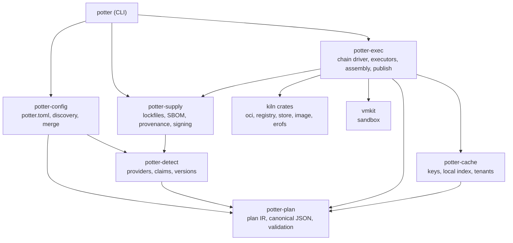
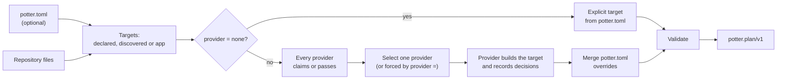
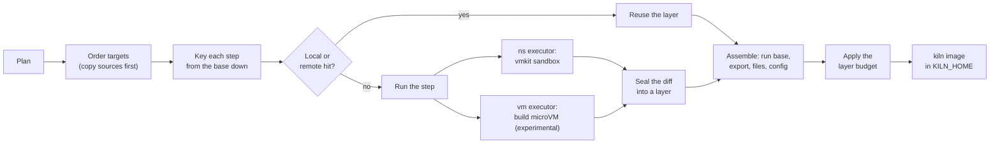
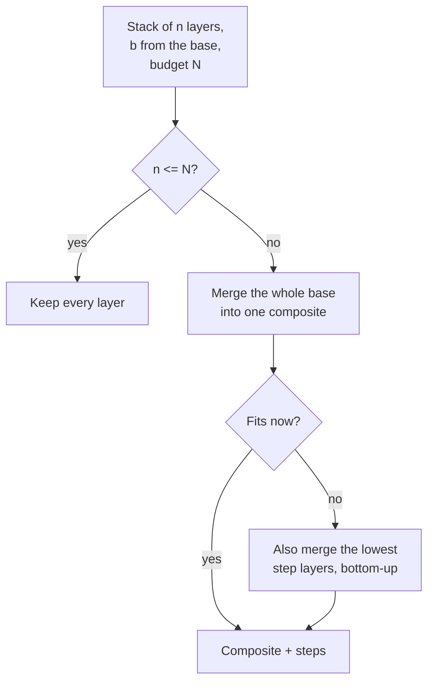
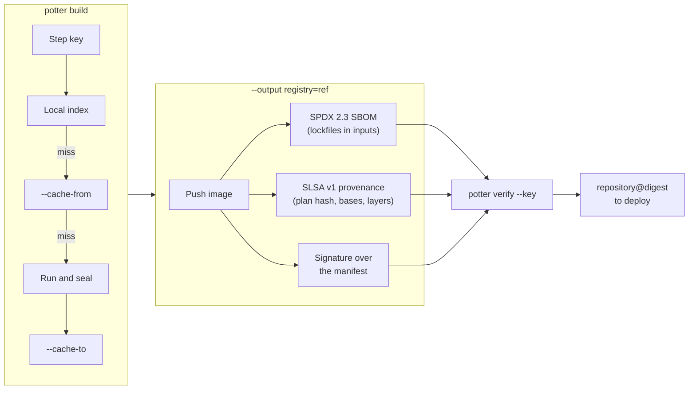
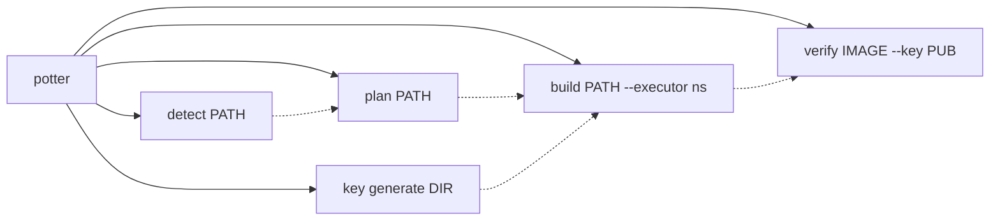

# potter

potter builds [kiln](https://github.com/AlfonsoCampodonico/kiln) microVM images from source. It
detects PHP/Laravel, Node, Bun, Deno, static-site, Python, Ruby, Go and Rust projects (or reads an
explicit `potter.toml`), turns what it finds into a canonical build plan, runs that plan step by step
in an isolated executor, caches every step under a key of exactly what it declared, and assembles the
result into a kiln image of erofs layers. It exists so that a repository can become a bootable
microVM image without a Dockerfile, with input-precise caching and a supply-chain record of how the
image was made. Detection only parses files; it never runs your code.

## Status

| Area | State |
|---|---|
| Detection and planning (`potter detect`, `potter plan`) | Works on Linux and macOS. 10 providers: `php`, `laravel`, `node`, `bun`, `deno`, `static`, `python`, `ruby`, `go`, `rust` |
| `potter.toml` overrides, explicit plans, zero-config monorepo targets | Works |
| `potter build --executor ns` (rootless Linux namespaces) | Works, Linux only |
| Detected targets (catalog bases) | Built through a stopgap: catalog bases are lowered onto upstream Debian trixie images plus install steps (`potter-exec/src/stopgap.rs`) until the signed catalog exists |
| Remote cache, target graph and `copy`, `--affected`, build secrets, `--progress json` | Works |
| Layer budget and composite base | Works for every executor |
| `--output registry=`, SBOM, provenance, signing, `potter verify` | Works. KMS keys (`kms://`) are refused; there is no transparency log or keyless signing |
| `--executor vm` (one microVM per target chain) | Experimental: implemented against a backend trait and tested with a scripted VM. The CLI refuses it (exit 4) until kiln's build mode lands |
| PHP web images (nginx + php-fpm as kiln-init `services`) | Planned and refused at build time (exit 2) until kiln-init starts services. Laravel with Octane on Swoole has no services and is not affected |
| Catalog layers the stopgap cannot map (for example Octane's RoadRunner and FrankenPHP servers, several primary runtimes in one base) | Refused, naming the catalog milestone (P3) |
| Stage bases and the Dockerfile frontend | Not implemented (P5) |
| Signed runtime catalog (P3), build daemon (P7) | Not started |

`potter build` refuses unsupported parts of a plan by name, with the milestone that ships them
(exit 2).

## Quick start

Build the CLI and look at what it would do with one of the test fixtures. This part works on Linux
and macOS and needs no network.

```sh
cargo build --release
./target/release/potter detect fixtures/go-api
./target/release/potter plan fixtures/go-api --explain
./target/release/potter plan fixtures/monorepo-targets
./target/release/potter plan fixtures/go-api --json
```

`potter detect fixtures/go-api` prints the claims and the chosen provider:

```text
provider   kind       refines  evidence
go         backend    -        go.mod
chosen: go
```

Building an image needs Linux, vmkit's sandbox helper and the prerequisites listed under
[Building](#building):

```sh
export VMKIT_SANDBOX=/usr/local/bin/vmkit-sandbox
./target/release/potter build fixtures/go-api --executor ns
kiln run potter/app:latest
```

The image is written to the kiln store (`$KILN_HOME`) and tagged `potter/<target>:latest`
(`--tag` overrides it for a single `--target`). There is no default executor: without
`--executor`, `potter build` exits 4 and says why.

## Concepts

- **Plan.** The canonical `potter.plan/v1` document (RFC 8785 JSON) that every frontend produces and
  the engine executes. It has one entry per target; see [docs/plan-format.md](docs/plan-format.md)
  and the JSON Schema in [docs/schema/potter.plan.v1.json](docs/schema/potter.plan.v1.json).
- **Targets.** A target is one image: a build root, a provider, a build chain (a base plus ordered
  steps: `inputs`, `run`, `copy_from`, `apt`, `meta`) and an image description (run base, `export`
  paths, generated files, config, processes, services). A repository has the implicit `app` target,
  the `[target.<name>]` tables of its `potter.toml`, or, when the root matches no provider, one
  discovered target per directory with its own manifest (top level, `apps/*`, `services/*`).
- **Detectors.** Each provider inspects the files of a build root and either claims it, with
  evidence, or not. A selection step resolves overlapping claims (Laravel refines PHP; a PHP backend
  absorbs asset-only JS; ambiguous roots are an error that asks for `provider = ...`). The chosen
  provider builds the target, then `potter.toml` keys are merged over it, and every decision is
  recorded so `potter plan --explain` can show where it came from.
- **Cache.** A step's key is a SHA-256 chain over its parent's key, the step itself, its inputs
  digest, its effective environment, a tenant-keyed HMAC of its secrets, the platform, the executor
  class and potter's major version. Source files that no `inputs` step includes are invisible to
  every step, so changing them rebuilds nothing. The local index lives in `$POTTER_HOME`; an optional
  remote cache stores entries as OCI artifacts per tenant.
- **Layer budget.** Every layer is a virtio-blk disk in the microVM, so an image has at most
  `max_layers` layers (default 10, range 3-128). Over the budget, the base image's layers merge into
  one composite first, then the lowest step layers. See [docs/layer-budget.md](docs/layer-budget.md).

## Architecture

### Crates



*The workspace crates and their dependencies; kiln and vmkit are pinned by git revision.*

### Planning



*How a repository becomes a plan: detectors and `potter.toml` are both frontends to the same IR.*

### Building



*The build pipeline: only cache misses run, and both executors hand their layers to the same assembly.*

`potter build --executor ns` runs `run` steps in rootless Linux namespaces through vmkit's sandbox.
Each step gets an overlay of its base and earlier layers, a nested user namespace with no capability
over its network namespace, and seccomp. A step has no network unless the plan gives it one
(`network = true`), and then only through vmkit's egress policy. Each step's diff is sealed into a
layer and recorded in the cache.

The image is the run base, the `export` paths, and the generated files, converted by kiln. Every
manifest carries the plan's labels and the annotations `dev.potter.port`, `dev.potter.process.<name>`
and `dev.potter.target` (the target's canonical hash).

Requirements for the namespace executor (Linux only):
- `newuidmap`/`newgidmap` (the `uidmap` package);
- a range of at least 65536 ids in `/etc/subuid` and `/etc/subgid`;
- `pasta`, `nft` and `ip`;
- vmkit's `vmkit-sandbox` helper (`$VMKIT_SANDBOX`, next to `potter`, or on `PATH`), with its
  AppArmor profile where Ubuntu restricts user namespaces.

The VM executor boots one microVM per target chain with every layer attached as an erofs disk. It is
built against a `BuildBackend` trait and exercised with a scripted fake VM; the real backend waits for
kiln's build mode. The executor class is part of every `run` step's key: VM builds look up VM entries
only, while namespace builds may reuse VM entries.

`$POTTER_HOME` (default `~/.local/share/potter`) holds the cache index (`cache/<tenant>/index/`),
unpacked layers (`unpacked/`), cache mounts (`mounts/<tenant>/`) and tenant keys. Layer blobs live in
`$KILN_HOME`.

### Layer budget



*The composite policy: merging the base first keeps the composite shared by every image on that base.*

Set the budget with `[target.<name>.image] max_layers` or `--max-layers` (3-128). The practical
ceiling is the VMM's device count: 13 layers for Firecracker on x86_64 with a network (potter warns
above it), 26 for Cloud Hypervisor, 88 for Firecracker on aarch64. potter steers kiln's own squash
and refuses the image (exit 4) if kiln merges a different number of layers than chosen.

### Cache and supply chain



*Remote cache lookups and publication; attestations are OCI referrers that `potter verify` checks.*

- **Remote cache:** `--cache-to <registry>[/<prefix>]` publishes every step of a chain (local hits
  too), and `--cache-from` looks up local misses there. `POTTER_REMOTE_CACHE` sets both. Entries live
  under `<prefix>/<tenant>/cache`, so tenants share nothing. Pulled layers are digest-verified and
  checked the way kiln ingests layers. A cache failure is a warning, never a failed build.
- **Graph:** targets build after the targets they copy from. A `potter.toml` step can be
  `copy = { from = "web", paths = ["/app/dist"], dest = "/srv/www", owner = "33:33" }` instead of
  `run`; it follows the placement rules of `COPY --from`.
- **`--affected <git-ref>`:** builds only the targets whose plan or inputs changed since the ref, plus
  what they copy from. The rest are reported `unchanged`.
- **Secrets:** `--secret id=<id>,src=<file>`, used by steps that list `secrets = ["<id>"]`. Each is
  mounted read-only at `/run/secrets/<id>` for that step only, never reaches a layer, enters the cache
  key as a tenant-keyed HMAC, and is redacted from logs (best effort).
- **Publishing:** `--output registry=<ref>` (with exactly one `--target`) pushes the image and
  attaches an SPDX 2.3 SBOM, SLSA v1 provenance and, with `--sign-key`, a signature. The SBOM lists the
  base images, catalog layers and the packages of the lockfiles in the target's declared inputs
  (12 formats); nothing is guessed or scanned. Referrers are listed under the tag
  `sha256-<image digest hex>` (the OCI referrers tag schema), so any registry serves them.
- **Signing:** `--sign-key <pem>` signs all three as sigstore bundles (v0.3, ECDSA P-256). Without it
  the statements are attached unsigned and `potter verify` fails.
- **Verifying:** `potter verify <ref> --key <pub>` checks every attestation against the key, the image
  digest and the repository being verified (`--expect-tenant` and `--expect-builder` add those). It
  exits 3 when any check fails. Its last line is `<repository>@<digest>`: deploy that, not the tag.

## Command reference



*The CLI commands in the order a typical workflow uses them.*

| Command | What it does |
|---|---|
| `potter detect [PATH]` | Lists each provider's claim on `PATH` with its evidence, and the chosen one |
| `potter plan [PATH] [--target T] [--json \| --explain] [--max-layers N]` | Prints the plan; `--json` prints canonical `potter.plan/v1`; `--explain` shows where every decision came from |
| `potter build [PATH] --executor ns [options]` | Builds images into `$KILN_HOME` (see below) |
| `potter verify IMAGE --key PUB [--expect-tenant T] [--expect-builder B]` | Checks a pushed image's SBOM, provenance and signature |
| `potter key generate DIR` | Writes `DIR/potter.key` (0600, PKCS#8 P-256) and `DIR/potter.pub` |

`potter build` options:

| Option | Meaning |
|---|---|
| `--executor ns\|vm` | Required. `vm` exits 4 until kiln's build mode lands |
| `--target T` | Only build these targets (repeatable; default all) |
| `--tag REF` | Tag the image (default `potter/<target>:latest`); needs exactly one `--target` |
| `--tenant ID` | Whose cache this build uses (default `local`) |
| `--tenant-key-file F` | The tenant's 32-byte cache key, raw or hex (default: kept in `$POTTER_HOME`) |
| `--no-cache` | Run every step, ignoring the cache |
| `--cache-from`, `--cache-to` | Remote cache `<registry>[/<prefix>]` (default `$POTTER_REMOTE_CACHE`) |
| `--affected REF` | Only build targets that changed since a git ref |
| `--secret id=ID,src=FILE` | A build secret for steps that mount it |
| `--max-layers N` | Layer budget for every target (3-128), over `potter.toml` |
| `--progress auto\|plain\|json` | `json`: one event per line on stdout ([event schema](docs/plan-format.md#progress-events---progress-json-spec-11)) |
| `--output registry=REF` | Push the image with its attestations; needs exactly one `--target` |
| `--sign-key PEM` | Sign the pushed image and attestations; needs `--output` |
| `--builder-id ID`, `--source-revision REV` | Recorded in provenance (defaults: `https://potter.dev/builder/local`, the checkout's `HEAD`) |

### Exit codes

| Code | Meaning |
|---|---|
| 0 | success |
| 1 | a build step failed, or the build output exceeded its limits |
| 2 | usage, config, plan or detection error (including a missing path, and features a later milestone ships) |
| 3 | a sandbox violation (a hostile layer or step output), or a failed `potter verify` |
| 4 | infrastructure: I/O, the registry, a missing prerequisite, no executor chosen |

## How potter relates to kiln and vmkit

potter is one of three projects. The dependency direction is potter -> kiln -> vmkit; nothing depends
upward.

| Project | Role |
|---|---|
| [vmkit](https://github.com/AlfonsoCampodonico/vmkit) | microVM toolkit: Firecracker and Cloud Hypervisor behind one trait, the unprivileged sandbox, networking |
| [kiln](https://github.com/AlfonsoCampodonico/kiln) | The image format (erofs layers plus init), OCI conversion, the store and registry client, and `kiln run` |
| potter | Source to kiln image: detection, the plan, executors, cache and supply chain |

potter uses kiln's crates (`kiln-oci`, `kiln-registry`, `kiln-store`, `kiln-image`, `kiln-erofs`) to
resolve bases, store blobs, push and pull, and convert the assembled OCI image into a kiln image. It
uses vmkit's sandbox to run namespace-executor steps. Both are pinned by git revision in
`crates/*/Cargo.toml`.

## Testing

```sh
cargo fmt --all --check
cargo clippy --all-targets -- -D warnings
cargo test --all
```

- Detector tests live in `crates/potter-detect/tests/`; planning tests snapshot the plan of each
  sample project under `fixtures/` with insta (`crates/potter-config/tests/snapshots/`; review
  changes with `cargo insta review`).
- End-to-end namespace builds (`crates/potter/tests/sandboxed.rs`, `build.rs`) skip without
  `VMKIT_SANDBOX`; set `POTTER_REQUIRE_SANDBOX_TESTS=1` to make a missing sandbox fail instead.
- Builds of detected projects from real upstream images run only with `POTTER_TEST_NETWORK=1`.
- Layer-budget timings: `cargo test --release -p potter-exec --test layer_budget -- --ignored --nocapture timings`.

CI ([.github/workflows/ci.yml](.github/workflows/ci.yml)) runs fmt, clippy and tests on Ubuntu and
macOS, plus a sandbox job that builds vmkit's sandbox helper at the pinned revision and runs the
end-to-end builds.

## Repository layout

```text
crates/
  potter/          CLI (main.rs, render.rs) and end-to-end tests
  potter-plan/     plan IR, canonical JSON, hashing, validation, layer budget limits
  potter-detect/   providers, claim selection, version parsing
  potter-config/   potter.toml, target discovery, overrides, planning pipeline
  potter-cache/    cache keys, local index, tenants
  potter-exec/     chain driver, namespace and VM executors, assembly, remote cache, publish, attest
  potter-supply/   lockfile parsers, SBOM, provenance, sigstore signing
docs/              user docs, plan schema, design spec and plans
fixtures/          sample projects used by the tests
```

## Documentation

See [docs/README.md](docs/README.md) for the full index.

- [Plan format](docs/plan-format.md): the plan, `potter.toml` keys, cache keys, remote cache entries,
  progress events, annotations, attestations
- [Layer budget](docs/layer-budget.md): the device ceiling, composite policy and measurements
- [Plan JSON Schema](docs/schema/potter.plan.v1.json)
- [Design spec](docs/superpowers/specs/2026-10-04-potter-design.md)
- [Roadmap](docs/superpowers/ROADMAP.md) and [handoff notes](docs/superpowers/HANDOFF.md)
- [Implementation plans](docs/superpowers/plans/)

## License

Apache-2.0. See [LICENSE](LICENSE).
